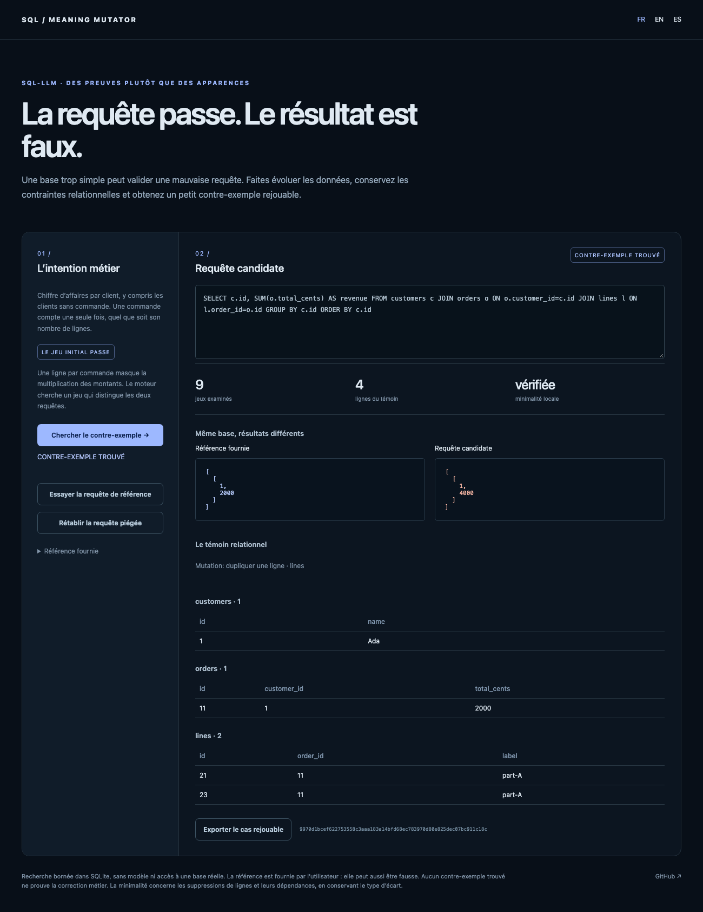

# SQL Meaning Mutator

[English](README.en.md) · [Español](README.es.md)

**Une requête SQL peut passer un test et pourtant doubler le chiffre d’affaires. Ce laboratoire produit la petite base qui le démontre.**

Le moteur exécute une requête candidate et une référence fournie, modifie les données relationnelles puis réduit le contre-exemple. Aucun LLM, aucune clé et aucune base réelle : les requêtes tournent dans de vraies bases SQLite en mémoire.



## Essayer

Python 3.11 ou supérieur, bibliothèque standard uniquement.

```sh
python3 -m sql_meaning serve --lang fr
```

Ouvrir `http://127.0.0.1:8766/?lang=fr`. Le jeu initial passe ; cliquer pour chercher un contre-exemple. Une ligne de commande dupliquée fait passer le total de **2 000 à 4 000 centimes**. Le témoin réduit conserve quatre lignes et toutes les contraintes déclarées. Essayer ensuite la requête de référence : l’absence de témoin n’est jamais présentée comme preuve de correction.

```sh
python3 -m sql_meaning search sql_meaning/examples/revenue.json > rapport.json
python3 -m sql_meaning search mon-contrat.json
python3 -m sql_meaning compare sql-counterexample.json
```

Code de sortie **1** : contre-exemple ou différence ; **0** : aucun témoin trouvé ou résultats identiques ; **2** : entrée ou requête initiale non valide. `pip install .` fournit aussi `sql-meaning`. CLI et interface sont en FR/EN/ES.

## Le contrat exécutable

Un dossier JSON contient `tables`, `reference_sql`, `candidate_sql` et, si nécessaire :

- `mutate_tables` : limiter les tables modifiables ;
- `numeric_boundaries` : valeurs frontières à explorer ;
- `required_children` : règles métier « chaque ligne parent possède au moins un enfant », décrites par `[parent_table, child_table, foreign_key]` ;
- `ordered: true` : comparer l’ordre des lignes. Par défaut, la comparaison utilise des multiensembles et conserve les doublons.

Colonnes `INTEGER`, `REAL`, `TEXT`, clé primaire simple, clés étrangères simples et nullabilité explicite sont prises en charge. Chaque ligne fournit toutes les colonnes. Les mutations clonent ou suppriment des lignes, introduisent `NULL` quand autorisé, et explorent valeurs numériques frontières et voisines. Clés primaires, clés étrangères, types et contraintes d’enfants sont vérifiés avant de considérer un témoin.

La recherche en largeur est bornée en profondeur, nombre de cas et temps. Après une différence, le réducteur essaie des suppressions avec fermeture des dépendances étrangères. Il conserve le type d’écart : nombre de lignes ou valeurs. `row_deletion_minimal` ne vaut vrai qu’après épuisement de ces réductions ; **ce n’est pas un minimum global**, ni la preuve de la cause métier. Un budget épuisé conserve le témoin et indique que sa minimalité n’est pas prouvée.

Le rapport lie le cas initial à une empreinte SHA-256, décrit la mutation, fournit les deux résultats et conserve le dossier réduit. L’export navigateur est directement réexécutable avec `compare`.

## Ce que cela ne prouve pas

La référence est une hypothèse fournie, pas une vérité découverte. Si les deux requêtes partagent le même défaut ou si les mutations ne l’atteignent pas, aucun témoin n’apparaît. Les contraintes métier absentes ne sont pas devinées. `search_complete` signifie uniquement que l’espace borné configuré a été parcouru. Les flottants non entiers sont comparés exactement ; employer des centimes entiers pour les exemples financiers.

La recherche cible SQLite, pas l’équivalence générale de dialectes PostgreSQL, DuckDB ou MariaDB. Les écritures, `ATTACH`, les pragmas et fonctions de chargement d’extension/fichier sont interdits pendant l’évaluation ; le travail SQL et le nombre de résultats sont limités. Ce confinement n’est pas une isolation système contre des adversaires : utiliser des processus/conteneurs supplémentaires pour des requêtes réellement hostiles.

## Existant et différence

[SQLancer](https://github.com/sqlancer/sqlancer) cherche des défauts des moteurs de bases. [Test Suite SQL Evaluation](https://github.com/taoyds/test-suite-sql-eval) utilise des suites d’exécution pour évaluer des requêtes. Ce projet s’en inspire sans revendiquer une nouvelle théorie : il cherche **un contre-exemple relationnel autour de deux requêtes métier fournies**, avec contraintes déclarées et export minimal local. [Query Contract CI](https://github.com/gbesse/query-contract-ci) vérifie des contrats existants ; ici, les jeux sont mutés pour mettre à l’épreuve leur couverture. Aucun résultat SOTA n’est revendiqué.

## Validation

```sh
python3 -m unittest discover -s tests -v
npm ci
npx playwright install chromium
npm run test:browser
npm run format:check
```

Seize tests vérifient le témoin de jointure, sa réduction, les frontières numériques, `NULL`, la multiplicité, l’ordre, les contraintes, les budgets et les refus d’écritures/chargements. Parcours navigateur FR/EN/ES et mobile ; CI Python 3.11/3.12 et installation de la roue hors sources. Licence MIT ; alpha de recherche sur données synthétiques.
